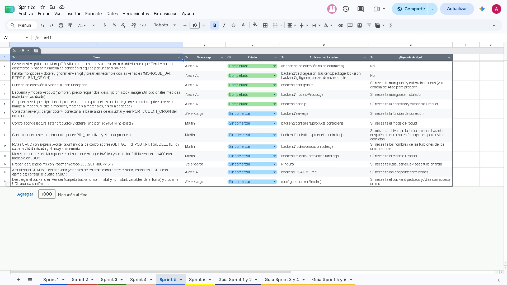
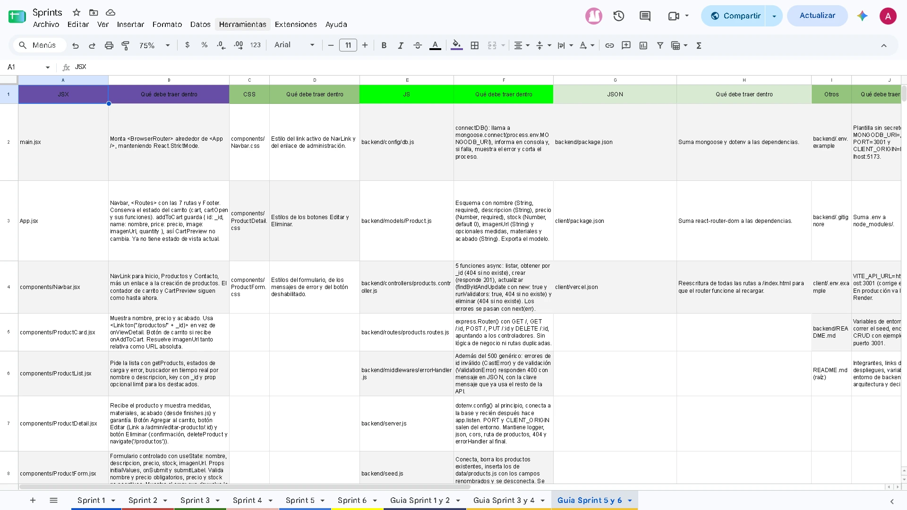

# E-commerce: Mueblería Hermanos Jota <!-- omit from toc -->

E-commerce desarrollado como proyecto final de la certificación Full Stack Developer. Simula una experiencia de compra (catálogo, detalle de producto y carrito) con un frontend en **React** que consume una API propia en **Node.js + Express**.

---

## Índice <!-- omit from toc -->

- [Integrantes](#integrantes)
- [Despliegue en Producción](#despliegue-en-producción)
- [Forma de trabajo](#forma-de-trabajo)
  - [Git](#git)
- [Descripción del proyecto](#descripción-del-proyecto)
  - [Funcionalidades principales](#funcionalidades-principales)
- [Tecnologías utilizadas](#tecnologías-utilizadas)
- [Estructura del proyecto](#estructura-del-proyecto)
- [Arquitectura y decisiones tomadas](#arquitectura-y-decisiones-tomadas)
- [Instalación y ejecución](#instalación-y-ejecución)
  - [1. Backend (puerto 3001)](#1-backend-puerto-3001)
  - [2. Frontend (puerto 5173)](#2-frontend-puerto-5173)
  - [Variables de entorno](#variables-de-entorno)
- [API](#api)
- [Flujo de trabajo](#flujo-de-trabajo)

---

## Integrantes

- [Alexis Antiñanco](https://github.com/1devLion)
- [Martin Bentancor](https://github.com/bentadev)
- [Kevin Jonathan Puca Patiño](https://github.com/KevinJPP)

> **Nota:** [Tamara Guidetti](https://github.com/Tamy594) (sprints 3–4) y [Ramiro Rosales](https://github.com/ramirosales52) (sprints 5–6) integraron el equipo en etapas anteriores y se dieron de baja del programa. Sus aportes quedaron reflejados en el historial de commits del repositorio.

---

## Despliegue en Producción

- **Frontend (Vercel):** https://muebleriahermanosjota-orpin.vercel.app
- **Backend (Render):** https://muebleria-hermanos-jota-ntpd.onrender.com

---

## Forma de trabajo

Trabajamos por sprints y, mediante una especie de pseudo-Jira: organizamos las tareas en Google Docs.

- **Tabla de tareas (una por sprint):** columnas Tarea, Se encarga, Estado, Archivos involucrados y ¿Depende de algo?
- **Tabla guía (una cada dos sprints):** para cada archivo, qué debe traer adentro.

<details>
<summary>Ver tabla de tareas del sprint 5</summary>



</details>

<details>
<summary>Ver tabla guía de los sprints 5 y 6</summary>



</details>

Cada uno elige las tareas que desea hacer. Si la tarea depende de un archivo previo enlazado a una tarea anterior, esta no puede comenzar hasta que el archivo previo esté terminado. Hay 4 estados: Sin completar, En curso, Completado y Esperando dependencias. Cuando alguien termina una tarea, marca esa casilla como completada.

### Git

- Una rama por tarea, con nombre `tipo/descripcion-corta` (por ejemplo, `feat/backend-configuracion-mongodb`).
- Commits con Conventional Commits y la descripción en español: `feat(backend): agregar modelo Product`.
- No se commitea directo a `main`: los cambios se integran con Pull Request.
- Cada tarea indica de qué otra depende y cada archivo tiene un solo responsable por tarea, para evitar conflictos al mergear.

## Descripción del proyecto

E-commerce de la Mueblería Hermanos Jota con un frontend en React y una API propia en Node.js + Express que guarda los productos en MongoDB Atlas. Permite navegar el catálogo, ver el detalle de cada producto (materiales, acabado y programa de garantía), simular el armado de un carrito de compras y administrar los productos (crear, editar y eliminar).

### Funcionalidades principales

- **Inicio** con banner principal (Hero) y 3 productos destacados
- **Catálogo** (`/productos`) con buscador en tiempo real por nombre o descripción, y estados de carga y error
- **Detalle de producto** (`/productos/:id`) con imagen, descripción, medidas, materiales, acabado, programa de garantía, botón para añadir al carrito y botones Editar y Eliminar (con confirmación)
- **Administración de productos:** alta (`/admin/crear-producto`) y edición (`/admin/editar-producto/:id`) con un mismo formulario controlado y validación del lado del cliente. Todavía no tiene autenticación
- **Carrito simulado** con contador en el Navbar y vista previa desplegable (sumar, restar, quitar, vaciar, total y compra simulada). El estado vive en `App.jsx` y se reinicia al recargar la página
- **Formulario de contacto** (`/contacto`) controlado, con validación del lado del cliente y mensaje de éxito. No envía los datos a ningún servidor
- **Página 404** para las rutas que no existen
- **API REST** con CRUD completo de productos, CORS restringido al cliente, logger de peticiones y manejo centralizado de errores

---

## Tecnologías utilizadas

- **Frontend:** React 19, React Router DOM 7, Vite, CSS3 (variables CSS para la identidad de marca)
- **Backend:** Node.js 20.19 o superior, Express 5, Mongoose 9, dotenv, cors
- **Base de datos:** MongoDB Atlas
- **Despliegue:** Vercel (frontend) y Render (backend)
- **Git y GitHub:** control de versiones en equipo, con ramas por tarea y Pull Requests

---

## Estructura del proyecto

```
muebleria_hermanos_jota/
├── backend/                  API REST (Express + Mongoose)
│   ├── config/db.js          Conexión a MongoDB
│   ├── controllers/          products.controller.js (lógica del CRUD)
│   ├── data/products.js      Catálogo inicial (lo usa seed.js)
│   ├── middlewares/          logger y errorHandler
│   ├── models/Product.js     Esquema y modelo de producto
│   ├── routes/               products.routes.js (rutas de /api/productos)
│   ├── seed.js               Carga el catálogo inicial en la base
│   └── server.js
├── client/                   Aplicación React (Vite)
│   ├── public/img/           Imágenes de productos, banner y logo
│   ├── vercel.json           Rewrite para que funcionen las rutas de la SPA
│   └── src/
│       ├── components/       Navbar, Hero, Footer, ProductCard, ProductList,
│       │                     ProductDetail, ProductForm, CartPreview, ContactForm
│       ├── data/             Acabados y programa de garantía
│       ├── pages/            Inicio, Productos, ProductoDetalle, Contacto,
│       │                     AdminCrearProducto, AdminEditarProducto, NotFound
│       ├── services/         productsApi.js (llamadas a la API)
│       ├── utils/            imageSrc.js
│       ├── App.jsx           Rutas y estado del carrito
│       └── config.js         URL base de la API
├── legacy/                   Primera versión del sitio (sprints 1 y 2, HTML/CSS/JS puro); ya no se usa
└── docs/img/                 Capturas del tablero de tareas
```

---

## Arquitectura y decisiones tomadas

El proyecto es una aplicación cliente-servidor: el frontend no tiene datos de productos propios, los pide a la API, y la API los guarda en MongoDB.

**Backend (`/backend`)**
- Express con las rutas separadas en un `express.Router` (`routes/products.routes.js`). Las rutas solo asignan cada endpoint a su controlador; la lógica vive en `controllers/products.controller.js`.
- **Modelo `Product`** (Mongoose): `nombre` (obligatorio), `descripcion`, `precio` (obligatorio, no negativo), `stock` (entero no negativo, por defecto 0), `imagenUrl` y, opcionales, `medidas`, `materiales` y `acabado`. Mongoose agrega `createdAt` y `updatedAt` automáticamente (`timestamps`).
- Las respuestas son JSON plano (array u objeto) y los errores siempre llegan como `{ mensaje }`.
- Middlewares: `logger` global (método y URL), `express.json()`, CORS habilitado solo para `CLIENT_ORIGIN`, un manejador de 404 en JSON y un `errorHandler` centralizado al final de la cadena (ids con formato inválido y errores de validación responden 400).
- `server.js` conecta a la base antes de empezar a escuchar; si la conexión falla, el proceso termina.
- Los secretos (cadena de conexión) van en `backend/.env`, que no se sube al repositorio.

**Frontend (`/client`)**
- **React Router DOM:** `BrowserRouter` en `main.jsx` y las rutas en `App.jsx`. Se usa `useParams` en el detalle y la edición, y `useNavigate` para navegar después de crear, editar o eliminar un producto.
- `services/productsApi.js` centraliza los `fetch` a la API y lanza un `Error` con el mensaje que devuelve el backend.
- `ProductList`, `ProductoDetalle` y `AdminEditarProducto` piden los datos en un `useEffect` y manejan los estados de carga y error (el detalle también distingue "no encontrado"). La página de edición ignora la respuesta si el componente se desmonta antes de que llegue.
- `ProductForm` es un formulario controlado que se reutiliza para crear y editar; valida nombre, precio y que el stock sea un entero no negativo.
- **El carrito es estado de `App.jsx`** (`useState`): las funciones agregar, incrementar, decrementar, quitar y vaciar viven ahí; el contador llega al Navbar por props. No se guarda en el navegador.
- Los acabados y el programa de garantía están en `client/src/data`: el backend solo guarda el id del acabado de cada producto.
- El cliente se creó con **Vite** en lugar de `create-react-app`, que está discontinuado.

---

## Instalación y ejecución

Necesitás **Node.js 20.19 o superior**, **npm** y una base en **MongoDB Atlas**. Hay que levantar los dos servidores, cada uno en su propia terminal.

### 1. Backend (puerto 3001)

```bash
cd backend
cp .env.example .env     # completá MONGODB_URI con tu cadena de Atlas
npm install
node seed.js             # opcional: carga los 11 productos (borra los que haya)
npm start
```

La API queda en `http://localhost:3001`. Para comprobar que funciona, abrí `http://localhost:3001/api/productos`.

### 2. Frontend (puerto 5173)

```bash
cd client
npm install
npm run dev
```

La aplicación queda en `http://localhost:5173`. El catálogo, el detalle y la administración necesitan el backend corriendo; si no, muestran un mensaje de error de conexión.

### Variables de entorno

| Variable | Dónde | Obligatoria | Valor por defecto | Para qué sirve |
| --- | --- | --- | --- | --- |
| `MONGODB_URI` | backend (`.env`) | Sí | — | Cadena de conexión de MongoDB Atlas |
| `PORT` | backend (`.env`) | No | `3001` | Puerto de la API |
| `CLIENT_ORIGIN` | backend (`.env`) | No | `http://localhost:5173` | Único origen permitido por CORS |
| `VITE_API_URL` | client (`.env`) | No | `http://localhost:3001` | URL base de la API |

Hay plantillas en `backend/.env.example` y `client/.env.example`. El archivo `.env` real nunca se sube al repositorio. En producción, estas variables se configuran en el panel de cada servicio de hosting; Vite lee `VITE_API_URL` al compilar, así que tiene que estar definida antes del build.

---

## API

| Método | Ruta | Descripción | Respuestas |
| --- | --- | --- | --- |
| GET | `/` | Mensaje de bienvenida | 200 |
| GET | `/api/productos` | Listado completo de productos | 200 |
| GET | `/api/productos/:id` | Un producto por `_id` | 200, 400 (id inválido), 404 |
| POST | `/api/productos` | Crea un producto | 201, 400 (datos inválidos) |
| PUT | `/api/productos/:id` | Actualiza un producto | 200, 400, 404 |
| DELETE | `/api/productos/:id` | Elimina un producto | 200, 400, 404 |

Los errores responden `{ "mensaje": "..." }`. Hay ejemplos de cada endpoint en [`backend/README.md`](backend/README.md).

---

## Flujo de trabajo

Cada tarea se desarrolla en una rama propia (`feat/...`, `fix/...`, `chore/...`) y se integra a `main` mediante Pull Request.
