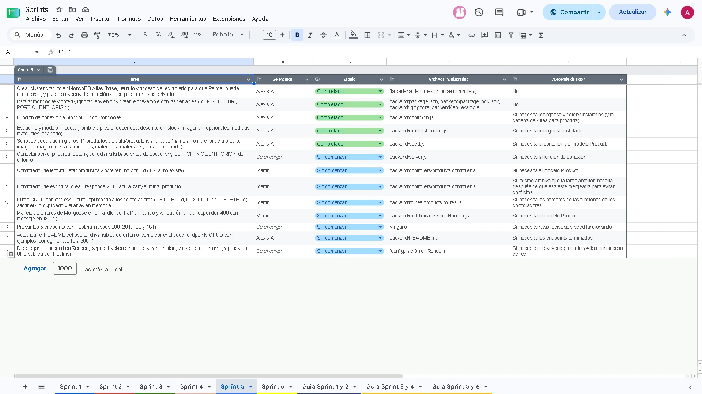
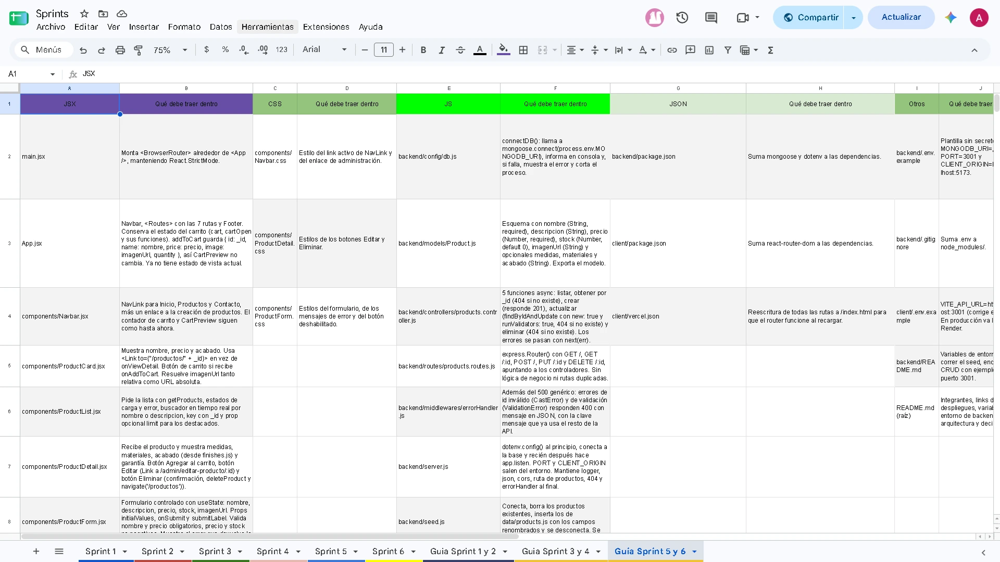

# E-commerce: Mueblería Hermanos Jota <!-- omit from toc -->

E-commerce desarrollado como proyecto final de la certificación Full Stack Developer. Simula una experiencia de compra (catálogo, detalle de producto y carrito) con un frontend en **React** que consume una API propia en **Node.js + Express**, conectada a **MongoDB Atlas**.

**Sitio en producción:** [muebleriahermanosjota-orpin.vercel.app](https://muebleriahermanosjota-orpin.vercel.app)
**API en producción:** [muebleria-hermanos-jota-ntpd.onrender.com](https://muebleria-hermanos-jota-ntpd.onrender.com/api/productos)

> El backend está en el plan gratuito de Render: se duerme tras unos minutos sin uso y la primera petición puede tardar cerca de un minuto en responder.

---

## Índice <!-- omit from toc -->

- [Integrantes](#integrantes)
- [Forma de trabajo](#forma-de-trabajo)
  - [Git](#git)
- [Descripción del proyecto](#descripción-del-proyecto)
  - [Funcionalidades principales](#funcionalidades-principales)
- [Tecnologías utilizadas](#tecnologías-utilizadas)
- [Estructura del proyecto](#estructura-del-proyecto)
- [Arquitectura y decisiones tomadas](#arquitectura-y-decisiones-tomadas)
- [Instalación y ejecución](#instalación-y-ejecución)
  - [1. Backend (puerto 3001)](#1-backend-puerto-3001)
  - [2. Frontend (puerto 5173)](#2-frontend-puerto-5173)
  - [Variables de entorno](#variables-de-entorno)
- [Despliegue](#despliegue)
- [API](#api)
- [Flujo de trabajo](#flujo-de-trabajo)

---

## Integrantes

- [Alexis Antiñanco](https://github.com/1devLion)
- [Martin Bentancor](https://github.com/bentadev)
- [Kevin Jonathan Puca Patiño](https://github.com/KevinJPP)

> **Nota:** [Tamara Guidetti](https://github.com/Tamy594) (sprints 3–4) y [Ramiro Rosales](https://github.com/ramirosales52) (sprints 5–6) integraron el equipo en etapas anteriores y se dieron de baja del programa. Sus aportes quedaron reflejados en el historial de commits del repositorio.

---

## Forma de trabajo

Trabajamos por sprints y, mediante una especie de pseudo-Jira: organizamos las tareas en Google Docs.

- **Tabla de tareas (una por sprint):** columnas Tarea, Se encarga, Estado, Archivos involucrados y ¿Depende de algo?
- **Tabla guía (una cada dos sprints):** para cada archivo, qué debe traer adentro.

<details>
<summary>Ver tabla de tareas del sprint 5</summary>



</details>

<details>
<summary>Ver tabla guía de los sprints 5 y 6</summary>



</details>

Cada uno elige las tareas que desea hacer. Si la tarea depende de un archivo previo enlazado a una tarea anterior, esta no puede comenzar hasta que el archivo previo esté terminado. Hay 4 estados: Sin completar, En curso, Completado y Esperando dependencias. Cuando alguien termina una tarea, marca esa casilla como completada.

### Git

- Una rama por tarea, con nombre `tipo/descripcion-corta` (por ejemplo, `feat/backend-configuracion-mongodb`).
- Commits con Conventional Commits y la descripción en español: `feat(backend): agregar modelo Product`.
- No se commitea directo a `main`: los cambios se integran con Pull Request.
- Cada tarea indica de qué otra depende y cada archivo tiene un solo responsable por tarea, para evitar conflictos al mergear.

## Descripción del proyecto

El sitio permite navegar el catálogo de la mueblería, ver el detalle de cada producto (materiales, acabado y programa de garantía), simular el armado de un carrito de compras y administrar los productos (alta, edición y baja). Los 11 productos viven en MongoDB Atlas y los entrega el backend; los acabados y el programa de garantía "Herencia Viva" viven en el cliente (`client/src/data`).

### Funcionalidades principales

- **Inicio** con tres productos destacados
- **Catálogo** con la grilla completa de productos y buscador en tiempo real por nombre o descripción, con estados de carga y error
- **Detalle de producto** con imagen, descripción, dimensiones, materiales, acabado, programa de garantía y botón para añadir al carrito
- **Carrito simulado** con contador en el Navbar, vista previa desplegable (sumar, restar, quitar, vaciar, total y compra simulada). El estado vive en `App.jsx`
- **Navegación con React Router**: cada vista tiene su propia URL (`/`, `/productos`, `/productos/:id`, `/contacto`, `/admin/crear-producto` y `/admin/editar-producto/:id`) y hay una página 404 para las rutas que no existen. `client/vercel.json` redirige todas las rutas a `index.html`, así que recargar o compartir un link funciona también en producción
- **Administración de productos** desde el propio sitio: formulario de alta (`/admin/crear-producto`), edición y botón Eliminar con confirmación en el detalle de cada producto, todo conectado al CRUD de la API
- **Formulario de contacto** controlado, con validación del lado del cliente y mensaje de éxito
- **API REST** propia con CRUD completo, persistencia en MongoDB, CORS restringido al cliente, logger de peticiones y manejo centralizado de errores

---

## Tecnologías utilizadas

- **Frontend:** React 19, React Router 7, Vite, CSS3 (variables CSS para la identidad de marca)
- **Backend:** Node.js (20.19 o superior), Express 5, Mongoose 9, cors
- **Base de datos:** MongoDB Atlas
- **Despliegue:** Vercel (frontend) y Render (backend)
- **Git y GitHub:** control de versiones en equipo, con ramas por tarea y Pull Requests

---

## Estructura del proyecto

```
muebleria_hermanos_jota/
├── backend/              API REST (Express + Mongoose)
│   ├── config/           Conexión a MongoDB (db.js)
│   ├── controllers/      Lógica de cada endpoint de productos
│   ├── data/             Catálogo original (fuente del seed)
│   ├── middlewares/      logger y errorHandler
│   ├── models/           Modelo Product
│   ├── routes/           Rutas de /api/productos
│   ├── seed.js           Carga el catálogo inicial en la base
│   └── server.js
└── client/               Aplicación React (Vite)
    ├── public/img/       Imágenes de productos y logo
    ├── vercel.json       Configuración de Vercel
    └── src/
        ├── components/   Navbar, Footer, ProductCard, ProductList, ProductDetail,
        │                 ProductForm, CartPreview, ContactForm
        ├── data/         Acabados y programa de garantía
        ├── pages/        Inicio, Productos, ProductoDetalle, Contacto,
        │                 AdminCrearProducto, AdminEditarProducto, NotFound
        ├── services/     Llamadas a la API (productsApi.js)
        ├── utils/        imageSrc.js (resuelve rutas relativas y URLs de imagen)
        ├── App.jsx       Rutas y estado del carrito
        ├── main.jsx      Punto de entrada, con BrowserRouter
        └── config.js     URL base de la API
```

---

## Arquitectura y decisiones tomadas

El proyecto es una aplicación cliente-servidor: el frontend no tiene datos de productos propios, los pide a la API.

**Backend (`/backend`)**
- Express con las rutas de productos separadas en un `express.Router` (`routes/products.routes.js`).
- Los datos se guardan en **MongoDB Atlas** y se acceden con **Mongoose** (modelo `Product`: `nombre`, `descripcion`, `precio`, `stock`, `imagenUrl`, más `medidas`, `materiales` y `acabado`). `node seed.js` carga el catálogo inicial.
- Middlewares: `logger` global (método y URL de cada petición), `express.json()` para leer el cuerpo de las peticiones POST y PUT, un manejador de 404 y un `errorHandler` centralizado al final de la cadena, que responde 400 ante errores de validación o ids inválidos.
- CORS habilitado solo para el origen del cliente (`CLIENT_ORIGIN`), no para cualquier origen.
- **Las rutas de escritura (POST, PUT y DELETE) son públicas.** La consigna no pide autenticación, así que cualquiera que conozca la URL de la API puede crear, modificar o borrar productos. Es una decisión consciente para el alcance del proyecto; en un sistema real irían detrás de un login. Si el catálogo se altera, `node seed.js` lo restaura, pero **borra todos los productos de la colección** antes de cargar los 11 originales, así que no hay que correrlo si se quiere conservar lo que se cargó a mano.

**Frontend (`/client`)**
- Un componente por responsabilidad (Navbar, Footer, ProductCard, ProductList, ProductDetail, ProductForm, CartPreview, ContactForm). Los datos bajan por props y los eventos suben con callbacks.
- **Las vistas se eligen con React Router.** `main.jsx` envuelve la app en `BrowserRouter` y `App.jsx` declara las rutas. El Navbar usa `NavLink` para marcar la sección activa, y la ruta `*` muestra una página 404.
- La página `ProductoDetalle` toma el `id` de la URL y pide el producto a `GET /api/productos/:id`, de modo que el detalle funciona al recargar o al abrir un link directo. Un 404 o un 400 (id con formato inválido) se muestran como "Producto no encontrado".
- `ProductForm` es el formulario controlado que comparten el alta y la edición. Valida nombre y precio en el cliente (el backend vuelve a validar) y manda `precio` y `stock` como números.
- **El carrito es estado de `App.jsx`** (`useState`). Las funciones agregar, incrementar, decrementar, quitar y vaciar viven ahí; el contador llega al Navbar por props y el desplegable del carrito recibe las funciones por props. El carrito no se guarda en el navegador: se reinicia al recargar la página.
- Las llamadas a la API están centralizadas en `productsApi.js`, que propaga el código de estado HTTP de los errores para que cada vista muestre el mensaje que corresponde.
- `ProductList` maneja tres estados (cargando, error, éxito) y se reutiliza en el inicio (con `limit`, sin buscador) y en el catálogo completo (con buscador en tiempo real por nombre o descripción).
- Los acabados y el programa de garantía están en `client/src/data`, porque el backend solo entrega los productos.
- `ContactForm` es un formulario controlado: un `useState` por campo y validación al enviar.
- El cliente se creó con **Vite** en lugar de `create-react-app`, que está discontinuado.

---

## Instalación y ejecución

Necesitás **Node.js 20.19 o superior** y **npm**, y una base de datos en **MongoDB Atlas** (o una instancia local de MongoDB). Hay que levantar los dos servidores, cada uno en su propia terminal.

### 1. Backend (puerto 3001)

Creá `backend/.env` a partir de `backend/.env.example` y completá `MONGODB_URI`. Después:

```bash
cd backend
npm install
node seed.js   # solo la primera vez: carga el catálogo inicial
npm start
```

> `node seed.js` **borra todos los productos** de la colección antes de insertar los 11 del catálogo original. No lo corras si ya cargaste productos que querés conservar.

La API queda en `http://localhost:3001`. Para comprobar que funciona, abrí `http://localhost:3001/api/productos`.

### 2. Frontend (puerto 5173)

```bash
cd client
npm install
npm run dev
```

La aplicación queda en `http://localhost:5173`. El catálogo y el detalle necesitan el backend corriendo; si no, muestran un mensaje de error de conexión.

### Variables de entorno

| Variable | Dónde | Obligatoria | Valor por defecto | Para qué sirve |
| --- | --- | --- | --- | --- |
| `MONGODB_URI` | backend (`.env`) | Sí | — | Cadena de conexión de MongoDB, con el nombre de la base antes del `?` |
| `PORT` | backend | No | `3001` | Puerto de la API (Render lo define solo) |
| `CLIENT_ORIGIN` | backend | No | `http://localhost:5173` | Único origen permitido por CORS |
| `VITE_API_URL` | client (`.env`) | No | `http://localhost:3001` | URL base de la API |

Los archivos `.env` **no se suben al repositorio**: las plantillas son `backend/.env.example` y `client/.env.example`. Si cambiás el puerto del cliente o del backend, ajustá `CLIENT_ORIGIN` y `VITE_API_URL` para que coincidan.

---

## Despliegue

| Parte | Plataforma | URL |
| --- | --- | --- |
| Frontend | Vercel | https://muebleriahermanosjota-orpin.vercel.app |
| Backend | Render | https://muebleria-hermanos-jota-ntpd.onrender.com |
| Base de datos | MongoDB Atlas | — |

**Backend en Render**
- Root Directory: `backend`
- Build Command: `npm install`
- Start Command: `npm start`
- Variables de entorno: `MONGODB_URI` y `CLIENT_ORIGIN` (la URL exacta del frontend en Vercel, con `https://` y sin barra final; si no coincide, el navegador bloquea las llamadas por CORS). `PORT` no hace falta.
- Render tiene que usar Node 20.19 o superior, que es lo que exige Mongoose 9. Se fija con el campo `engines` de `backend/package.json`: `"engines": { "node": ">=20.19.0" }`.

**Frontend en Vercel**
- Root Directory: `client`
- `client/vercel.json` redirige todas las rutas a `index.html`, necesario porque el sitio usa React Router.
- Variable de entorno: `VITE_API_URL` con la URL del backend en Render. Vite la lee al compilar, así que si cambia hay que volver a desplegar.

**MongoDB Atlas**
- En Network Access tiene que estar permitido el acceso desde cualquier IP (`0.0.0.0/0`), porque Render no tiene una IP fija.
- La cadena de conexión es un secreto: se carga solo en las variables de entorno de Render y nunca se sube al repositorio.

**Orden recomendado:** desplegar el backend con un `CLIENT_ORIGIN` provisorio, desplegar el frontend con `VITE_API_URL`, poner la URL real de Vercel en `CLIENT_ORIGIN` y redesplegar el backend. Por último, probar el flujo completo en producción.

---

## API

Documentación completa (campos, ejemplos y errores) en [`backend/README.md`](backend/README.md).

| Método | Ruta | Descripción |
| --- | --- | --- |
| GET | `/` | Mensaje de bienvenida |
| GET | `/api/productos` | Listado completo de productos |
| GET | `/api/productos/:id` | Un producto por id (400 si el id es inválido, 404 si no existe) |
| POST | `/api/productos` | Crea un producto (400 si faltan datos obligatorios) |
| PUT | `/api/productos/:id` | Actualiza un producto (400, 404) |
| DELETE | `/api/productos/:id` | Elimina un producto (400, 404) |

Los errores responden en JSON con la forma `{ "mensaje": "..." }`. Las rutas inexistentes responden un 404 en JSON.

---

## Flujo de trabajo

Cada tarea se desarrolla en una rama propia (`feat/...`, `fix/...`, `chore/...`) y se integra a `main` mediante Pull Request.