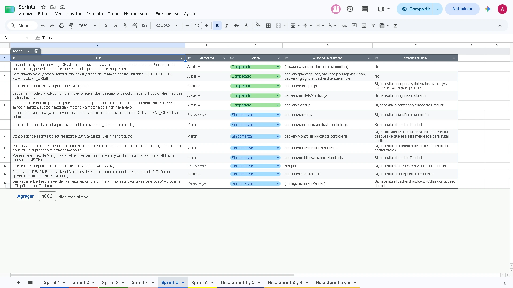
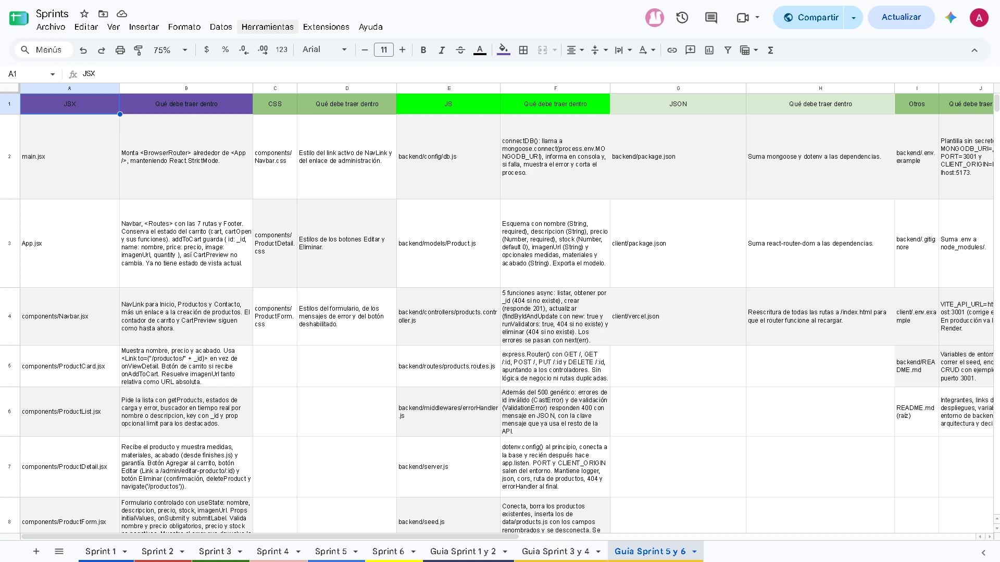

# E-commerce: Mueblería Hermanos Jota <!-- omit from toc -->

E-commerce desarrollado como proyecto final de la certificación Full Stack Developer. Simula una experiencia de compra (catálogo, detalle de producto y carrito) con un frontend en **React** que consume una API propia en **Node.js + Express**.

---

## Índice <!-- omit from toc -->

- [Integrantes](#integrantes)
- [Forma de trabajo](#forma-de-trabajo)
  - [Git](#git)
- [Descripción del proyecto](#descripción-del-proyecto)
  - [Funcionalidades principales](#funcionalidades-principales)
- [Tecnologías utilizadas](#tecnologías-utilizadas)
- [Estructura del proyecto](#estructura-del-proyecto)
- [Arquitectura y decisiones tomadas](#arquitectura-y-decisiones-tomadas)
- [Instalación y ejecución](#instalación-y-ejecución)
  - [1. Backend (puerto 3000)](#1-backend-puerto-3000)
  - [2. Frontend (puerto 5173)](#2-frontend-puerto-5173)
  - [Variables de entorno (opcionales)](#variables-de-entorno-opcionales)
- [API](#api)
- [Flujo de trabajo](#flujo-de-trabajo)

---

## Integrantes

- [Alexis Antiñanco](https://github.com/1devLion)
- [Martin Bentancor](https://github.com/bentadev)
- [Kevin Jonathan Puca Patiño](https://github.com/KevinJPP)

> **Nota:** [Tamara Guidetti](https://github.com/Tamy594) (sprints 3–4) y [Ramiro Rosales](https://github.com/ramirosales52) (sprints 5–6) integraron el equipo en etapas anteriores y se dieron de baja del programa. Sus aportes quedaron reflejados en el historial de commits del repositorio.

---

## Forma de trabajo

Trabajamos por sprints y, mediante una especie de pseudo-Jira: organizamos las tareas en Google Docs.

- **Tabla de tareas (una por sprint):** columnas Tarea, Se encarga, Estado, Archivos involucrados y ¿Depende de algo?
- **Tabla guía (una cada dos sprints):** para cada archivo, qué debe traer adentro.

<details>
<summary>Ver tabla de tareas del sprint 5</summary>



</details>

<details>
<summary>Ver tabla guía de los sprints 5 y 6</summary>



</details>

Cada uno elige las tareas que desea hacer. Si la tarea depende de un archivo previo enlazado a una tarea anterior, esta no puede comenzar hasta que el archivo previo esté terminado. Hay 4 estados: Sin completar, En curso, Completado y Esperando dependencias. Cuando alguien termina una tarea, marca esa casilla como completada.

### Git

- Una rama por tarea, con nombre `tipo/descripcion-corta` (por ejemplo, `feat/backend-configuracion-mongodb`).
- Commits con Conventional Commits y la descripción en español: `feat(backend): agregar modelo Product`.
- No se commitea directo a `main`: los cambios se integran con Pull Request.
- Cada tarea indica de qué otra depende y cada archivo tiene un solo responsable por tarea, para evitar conflictos al mergear.

## Descripción del proyecto

El sitio permite navegar el catálogo de la mueblería, ver el detalle de cada producto (materiales, acabado y programa de garantía) y simular el armado de un carrito de compras. Los 11 productos los entrega el backend; los acabados y el programa de garantía "Herencia Viva" viven en el cliente (`client/src/data`).

### Funcionalidades principales

- **Inicio** con banner principal y productos destacados
- **Catálogo** con la grilla completa de productos y buscador en tiempo real por nombre o descripción, con estados de carga y error
- **Detalle de producto** con imagen, descripción, dimensiones, materiales, acabado, programa de garantía y botón para añadir al carrito
- **Carrito simulado** con contador en el Navbar, vista previa desplegable (sumar, restar, quitar, vaciar, total y compra simulada). El estado vive en `App.jsx`
- **Formulario de contacto** controlado, con validación del lado del cliente y mensaje de éxito
- **Navegación entre vistas** (inicio, catálogo, detalle de producto y contacto) por renderizado condicional, sin router
- **API REST** propia con CORS restringido al cliente, logger de peticiones y manejo centralizado de errores

---

## Tecnologías utilizadas

- **Frontend:** React 19, Vite, CSS3 (variables CSS para la identidad de marca)
- **Backend:** Node.js, Express 5, cors
- **Git y GitHub:** control de versiones en equipo, con ramas por tarea y Pull Requests

---

## Estructura del proyecto

```
muebleria_hermanos_jota/
├── backend/              API REST (Express)
│   ├── data/             Catálogo de productos
│   ├── middlewares/      logger y errorHandler
│   ├── routes/           Rutas de /api/productos
│   └── server.js
└── client/               Aplicación React (Vite)
    ├── public/img/       Imágenes de productos y logo
    └── src/
        ├── components/   Navbar, Footer, Hero, ProductCard, ProductList,
        │                 ProductDetail, CartPreview, ContactForm
        ├── data/         Acabados y programa de garantía
        ├── pages/        Inicio, Productos, ProductoDetalle, Contacto (vistas)
        ├── App.jsx       Vista actual y estado del carrito
        └── config.js     URL base de la API
```

---

## Arquitectura y decisiones tomadas

El proyecto es una aplicación cliente-servidor: el frontend no tiene datos de productos propios, los pide a la API.

**Backend (`/backend`)**
- Express con las rutas de productos separadas en un `express.Router` (`routes/products.routes.js`).
- Los datos son un array de objetos en un archivo `.js` local (`data/products.js`), como pide la consigna.
- Middlewares: `logger` global (método y URL de cada petición), `express.json()` para futuras peticiones POST, un manejador de 404 y un `errorHandler` centralizado al final de la cadena.
- CORS habilitado solo para el origen del cliente, no para cualquier origen.

**Frontend (`/client`)**
- Un componente por responsabilidad (Navbar, Footer, ProductCard, ProductList, ProductDetail, CartPreview, ContactForm). Los datos bajan por props y los eventos suben con callbacks.
- **El carrito es estado de `App.jsx`** (`useState`). Las funciones agregar, incrementar, decrementar, quitar y vaciar viven ahí; el contador llega al Navbar por props y el desplegable del carrito recibe las funciones por props. El carrito no se guarda en el navegador: se reinicia al recargar la página.
- `ProductList` hace `fetch` a `GET /api/productos` y maneja tres estados (cargando, error, éxito). Se reutiliza en el inicio (con `limit`, sin buscador) y en el catálogo completo (con buscador en tiempo real).
- `ProductList` usa renderizado condicional según el estado de la petición (cargando, error o lista). `ProductDetail` no hace otro `fetch`: recibe por props el producto que ya trajo el listado y no muestra nada si no hay producto.
- Los acabados y el programa de garantía están en `client/src/data`, porque el backend solo entrega los productos.
- `ContactForm` es un formulario controlado: un `useState` por campo y validación al enviar.
- **Las vistas se eligen con renderizado condicional.** `App.jsx` guarda en estado la vista actual (`home`, `catalog`, `detail` o `contact`) y el producto elegido; el Navbar y las cards avisan con callbacks (`onNavigate`, `onViewDetail`). No se usa router, así que la URL no cambia entre vistas y al recargar la página se vuelve al inicio.
- El cliente se creó con **Vite** en lugar de `create-react-app`, que está discontinuado.

---

## Instalación y ejecución

Necesitás **Node.js 20 o superior** y **npm**. Hay que levantar los dos servidores, cada uno en su propia terminal.

### 1. Backend (puerto 3001)

```bash
cd backend
npm install
npm start
```

La API queda en `http://localhost:3001`. Para comprobar que funciona, abrí `http://localhost:3001/api/productos`.

### 2. Frontend (puerto 5173)

```bash
cd client
npm install
npm run dev
```

La aplicación queda en `http://localhost:5173`. El catálogo y el detalle necesitan el backend corriendo; si no, muestran un mensaje de error de conexión.

### Variables de entorno (opcionales)

| Variable | Dónde | Valor por defecto | Para qué sirve |
| --- | --- | --- | --- |
| `PORT` | backend | `3001` | Puerto de la API |
| `CLIENT_ORIGIN` | backend | `http://localhost:5173` | Único origen permitido por CORS |
| `VITE_API_URL` | client (`.env`) | `http://localhost:3001` | URL base de la API |

Si cambiás el puerto del cliente o del backend, ajustá `CLIENT_ORIGIN` y `VITE_API_URL` para que coincidan (hay un ejemplo en `client/.env.example`).

---

## API

| Método | Ruta | Descripción |
| --- | --- | --- |
| GET | `/` | Mensaje de bienvenida |
| GET | `/api/productos` | Listado completo de productos |
| GET | `/api/productos/:id` | Un producto por id (404 si no existe) |

---

## Flujo de trabajo

Cada tarea se desarrolla en una rama propia (`feat/...`, `fix/...`, `chore/...`) y se integra a `main` mediante Pull Request.
